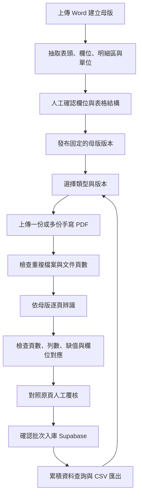

# DFIS Word 母版與手寫 PDF 累積建檔設計

版本：1.0。日期：2026-10-21。狀態：設計規格，尚未實作或部署。

## 1. 本次調整的成果定義

使用者先在網頁上傳某一類空白 Word 表單，確認欄位後建立可重複使用的母版。
日後選擇同一母版，上傳一份或多份對應的手寫 PDF，選用 Gemini 或 OpenAI 辨識，
人工覆核後存入 Supabase。後續再次上傳會新增批次並累積資料，既有紀錄繼續保留。
使用者可按母版、版本、日期與上傳批次匯出 CSV。

Word 是結構與欄位的依據；PDF 才是每次要擷取的作答或觀測資料。
母版印好的魚名、選項、示例文字及預填船名，不能直接當成已觀測的資料入庫。

本文件是 implementation_plan.md 的需求與設計附件，不另行取代其執行優先順序。
P0-A 已完成的是獨立 staging 的持久化閉環，尚未完成下述動態母版功能，也未切換正式 App。

## 2. 已檢查的輸入母版

| Word 來源 | 建議類型 | 已讀取的結構 | 設計重點 |
| --- | --- | --- | --- |
| 延繩釣漁撈作業報表-高雄熊麻吉 -.docx | TW_LONGLINE_001 釣具作業表 | 正文、表頭、漁法區、左右兩組漁獲欄位 | 左右皆是「魚種、尾數、重量(公斤)」；一張表同時包含多種漁法選項 |
| 台南將軍沿海場域標本船作業調查表109.03.31.docx | TN_COASTAL_GILLNET_001 沿海網具作業表 | 日期時間、下網位置、網具欄位、左右漁獲表 | 左右皆是「漁獲種類、重量(公斤)、尾數」，順序與釣具表不同 |
| 龍門漁業問卷.doc | LONGMEN_QUESTIONNAIRE_001 問卷，名稱待確認 | 已確認為舊式 OLE Word binary；尚未完整解析內容 | 須先轉 DOCX 並核對版面；題目、答案選項與重複明細待讀取後確認，不能先套用漁撈日誌欄位 |

前兩份的盤點為 Word 正文與表格結構讀取，尚不是逐頁渲染、圖形、頁首頁尾及文字方塊的完整定位驗收。
龍門問卷的欄位在轉檔讀取前不宣告確認。原始檔案保持不變，不將原始 Word 或其聯絡資訊提交公開 GitHub。

### 釣具作業表欄位起點

- 表頭：船名、填表人、作業日期、作業開始時間、結束時間。
- 位置：作業與結束的經緯度，保留原寫法與座標格式。
- 漁法：流刺網、曳繩釣、延繩釣、一支釣，依 PDF 實際勾選或填寫判讀，不以 Word 檔名直接決定。
- 參數：網目、網長、深度、漁具數及其單位、餌料等，依漁法保留適用欄位。
- 漁獲明細：原始魚種、尾數、重量 kg、來源頁碼、左右區塊、來源列。

### 將軍沿海作業表欄位起點

- 表頭：日期、出港與進港時間、下網與起網時間。
- 位置：下網經度、緯度；原表無明確欄位的內容不自行補造。
- 參數：作業深度與原單位、網具長度與原單位、網目吋。
- 漁獲明細：原始種類、重量 kg、尾數，以及頁碼、左右區塊與來源列。
- 原表的魚種名稱是列標籤。數值空白與明確填寫的 0 分開處理，不把所有預印魚種都變成零漁獲。

## 3. 使用者流程

母版只需建立一次。重啟 App 後仍可選取既有母版與資料，不能依賴 session_state 或容器本機檔案保留。
換一份手寫 PDF 會建立新批次；修改 Word 結構則建立新的母版版本。

## 4. 網頁畫面與必要操作

| 頁面 | 使用者操作 | 系統回饋 |
| --- | --- | --- |
| 表單類型與母版 | 新建類型、上傳 Word、填名稱、選漁撈／生物學／問卷／其他 | 顯示候選欄位、表格區塊與不支援的結構 |
| 母版欄位確認 | 修正中文名稱、欄位代碼、型別、單位、表頭或明細、必填與選項 | 草稿預覽、示例 CSV 欄名、發布新版本 |
| PDF 批次上傳 | 先選類型與版本，再選 Gemini／OpenAI；一次上傳多份 PDF | 檔名、頁數、重複狀態、每頁處理進度與費用會用到的頁數 |
| 覆核與確認 | 左側切換來源頁，右側編輯表頭與對應明細 | 原始值、標準值、缺頁缺列、低可信欄位與修改標記 |
| 累積資料與匯出 | 依母版、版本、日期、批次與確認狀態篩選 | 已確認資料列數、來源批次、下載 CSV／多表 CSV ZIP |

發布母版前至少確認一個有效資料欄位與資料列單位，不能只上傳檔案就宣告模板可用。
PDF 一般使用者只需選既有母版；母版管理的複雜設定不應出現在每次上傳的必要操作中。
問卷的實際受訪者、訪問日期等欄位，需待來源確認，不強制要求船名、魚種或漁獲重量。

## 5. 母版與版本規格

每個類型使用穩定 template_code；每次發布建立不可變的 version_id。
欄位以穩定 field_key 識別，中文顯示名稱與 CSV 名稱分開保存。
原表結構保留表格、列、欄、合併儲存格、左右重複區塊與文字標籤的來源定位。

每個 field 定義至少包含：

| 屬性 | 用途 |
| --- | --- |
| field_key / label_zh | 機器代碼與中文顯示名稱 |
| scope / group_key | 表頭欄位，或某一組可重複明細欄位 |
| data_type | text、integer、decimal、date、time、boolean、single_choice、multi_choice |
| source_unit / canonical_unit | 原單位與已確認的標準單位；單位不明時保留待確認 |
| required / choices | 真正必填條件與選項，不把空白當 0 |
| source_anchor | Word 表格與儲存格定位、標籤、左右區塊 |
| csv_column / standard_mapping | CSV 欄名及可選的既有 DFIS 標準欄位映射 |

同一 CSV 欄名與同 scope 的 field_key 均須唯一；欄位名稱不能用來直接拼接 SQL。
新版本不能靜默改變舊版的欄位含義、單位或數值型別。
同一 Word 檔名但內容 hash 不同，視為可能的新版本，不覆寫既有已發布版本。

### Word 檔案支援界線

- DOCX：讀取段落、表格、合併儲存格及必要的頁首頁尾／文字方塊；對無法定位的元素提出覆核。
- 純掃描影像嵌入的 Word：須做影像解析，不能以「沒有文字」當成空白母版。
- DOC：先辨認檔案格式，再經隔離的轉檔服務轉 DOCX，保留前後 hash 並確認轉檔結果。
- 在 DOC 轉檔服務完成前，介面明示要求使用者以 Word「另存為 DOCX」，不能只改副檔名或宣稱已支援 DOC。
- 巨集文件、加密檔、損毀檔與過大檔案，明確拒絕並保留可理解的原因。

## 6. PDF 辨識與覆核規則

1. 讀取實際頁數，為每頁建立待處理、成功、失敗、無觀測資料、待人工確認狀態。
2. 使用者選定的母版版本固定此批次 schema；AI 提供的檔內文字不能變更系統指令或欄位定義。
3. 先對照母版判斷是否為相符表單；不相符時停止自動入庫並請使用者重新選類型。
4. 漁撈表的表頭與左右明細分區讀取，按各母版的欄位順序映射，而非固定把第 2 欄當尾數。
5. 生物量測保留逐個體列；問卷保留題號、複選與自由文字，不強套 FisheryLogBatchSchema。
6. 每筆結果保留 upload_id、母版版本、source_page、source_section、source_row 或題號，以及 raw_value。
7. 日期保留原字串與標準值；明確的民國年才轉換，不能以檔名年分無條件蓋掉原文。
8. 空白、無法辨識、未作答、明確的 0 分開儲存；數值不能因解析缺值補成 0。
9. 預印魚名、預印選項與示例不算已作答；勾選、手寫數值與文字才構成觀測候選。
10. 跨頁續表可沿用已確認的表頭，但不同作業不得只因同船同日就合併成一筆。
11. 顯示每頁處理與每組資料列數。解析失敗可只重試失敗頁；不能少頁仍顯示「全部完成」。
12. 儲存前要求人工確認。部分頁失敗時只能明確選擇「保存已覆核部分」，並維持批次未完整狀態。

同一資料契約供 Gemini / OpenAI 使用，但各服務各自處理 schema 能力、截斷與暫時錯誤。
更換模型會建立另一筆 extraction run；不得靜默覆蓋人工已確認的值。

## 7. Supabase 累積資料的設計

現有 staging 表名與整數 legacy ID 已被 CRUD 使用，不直接覆蓋成動態 UUID 結構。
建議新增獨立的工作流程資料表，透過明確 adapter 對接既有漁撈／生物資料。
以下為邏輯模型，尚未執行 migration；實作時需再次盤點實際 constraints 與 CRUD。

| 邏輯資料表 | 主鍵與主要關聯 | 保存內容 |
| --- | --- | --- |
| template_definitions | id UUID；code UNIQUE | 類型、名稱、資料領域、啟用狀態 |
| template_versions | id UUID；template_id FK；UNIQUE(template_id,version) | Word 來源檔名/hash、不可變結構快照、field_specs JSONB、發布狀態 |
| document_uploads | id UUID；template_version_id FK；UNIQUE(template_version_id,pdf_sha256) | PDF 檔名/hash、頁數、上傳時間、整批確認狀態 |
| document_pages | id UUID；upload_id FK；UNIQUE(upload_id,page_no) | 每頁狀態、錯誤、辨識與覆核完成情況 |
| document_extraction_runs | id UUID；upload_id FK | provider、model、schema 版本、執行狀態、原始候選結果、錯誤摘要 |
| reviewed_documents | id UUID；upload_id FK；UNIQUE(upload_id,document_key) | 一份問卷或一次作業的已確認表頭與來源範圍 |
| reviewed_rows | id UUID；document_id FK；UNIQUE(document_id,group_key,row_key) | 一筆漁獲／個體／明細的已確認值、來源列、修正紀錄 |

reviewed_documents 與 reviewed_rows 的動態值使用 JSONB，查詢 key 僅來自該母版白名單。
常用日期與狀態可使用明確欄位及索引；不為每個 Word 類型建立一張動態命名的 SQL 表。
魚種、船名等可選標準化映射不能破壞原始內容；問卷仍可直接入通用資料層。
對接既有 fishery_logs / biological_parameters 時須避免雙寫不一致；同批確認交易需可 rollback。

### 持續上傳與避免重複

- 同母版版本、同 PDF bytes，即使改名再次上傳，也提示既有批次，不重複新增資料。
- 一份 PDF 可多次辨識，解析結果先保存為候選；確認入庫使用唯一鍵保證重試不重複。
- 不同 PDF 同名時依內容 hash 區分，不能僅以檔名重設或識別 Streamlit session。
- 同 PDF 已在另一母版或版本入庫時顯示跨類型重複提示，轉換歸屬須有明確操作。
- 每次確認一份 PDF 的表頭與明細放在同一交易，失敗時 rollback，避免只有主檔而沒有明細。
- 舊批次與新批次同時可查詢，累積數量明確顯示，不以新上傳取代舊資料。

### 原始檔保存

v1 必須持久保存母版結構快照、欄位定義、文件 hash、來源檔名及已確認資料。
原始 Word／PDF 檔本身的長期雲端保存另設範圍：目前 Storage 尚未納入實作，不能宣稱重啟後仍可下載原檔。
若先採不保存原始 PDF 的版本，畫面須提示自行保留原始檔；重新辨識或重新看圖需要再次上傳相同 hash 的檔案。
若要求跨次登入直接看原 PDF，須先完成私有物件儲存及存取設計後才可驗收該功能。

## 8. CSV 匯出契約

預設匯出「同類型、同母版版本、已覆核」資料，使用 UTF-8 BOM、固定欄序與一致的缺值表示。
檔案包含 template_code、template_version、upload_id、document_id、source_filename、source_page、source_row 等追溯欄位。

| 類型 | 一列代表什麼 | 匯出方式 |
| --- | --- | --- |
| 漁撈作業 | 一筆漁獲明細 | 重複帶入該作業的日期、船名、漁法與已確認背景欄位 |
| 生物量測 | 一個體的量測 | 每個體一列，保留編號、魚種、尾叉長／全長、重量與來源 |
| 問卷 | 一份作答 | 一題一欄；複選以明定格式的 JSON array 字串輸出，避免無法還原 |
| 多個明細群組 | 每個群組各一張表 | 匯出主檔 CSV 與各組明細 CSV 的 ZIP，共用 document_id，避免兩組明細交叉乘積 |

沒有明細的已確認主檔仍可匯出主檔 CSV，不能因 inner join 消失。
跨版本匯出預設分檔；只有經使用者確認的欄位映射才能合併，不自動混合意義不同的同名欄位。
數值以數字輸出、缺值留空；原始文字另欄保存。試算表公式開頭的文字採安全匯出規則，原值仍保留於資料庫。
可下載當次批次或歷次累積資料；匯出時間、篩選條件、列數、版本與 SHA-256 記入驗收或匯出紀錄。

## 9. 對現有程式的調整位置

| 現況 | 需要調整 |
| --- | --- |
| app.py 先選固定資料庫分類並單檔上傳 | 新增母版管理與先選母版版本的批次 PDF 流程 |
| 兩種固定 Pydantic batch | 保留既有標準 schema，另建立與母版 field_specs 對應的通用文件契約 |
| 依 last_filename 管理解析結果 | 改用內容 hash、母版版本、批次與 run ID，避免同名不同檔或跨母版殘留 |
| 生物表／漁撈表各自存檔 | 通用覆核結果先穩定保存，再透過明確 adapter 寫入適用的標準資料 |
| import_batches 等 shadow 部分使用 | 新流程資料來源、逐頁狀態與 idempotency 需要完整明確的 CRUD 與 migration |
| CSV 主要依固定魚種／生物欄位 | 按母版發布的欄位規格與明細群組產生 CSV |

現有 P0-A 的 TLS、無 fallback、啟動只讀 schema 檢查與重啟保存測試須持續成立。
新增資料層要有獨立的 PostgreSQL adapter；JSONB 和 UUID 不沿用 TEXT／整數的假設。

## 10. 開發與驗收順序

本次先確認設計，並將母版欄位與版本契約列為 P0-B 表單辨識工作的前置輸入。
implementation_plan.md 保持唯一優先順序基準：P0-B 保留 BIO_MESH_001 原有品質驗收，
完整多類型母版 UI、問卷及批次流程在 P1 擴充。本節下列項目說明新功能內部相依順序，
不表示可將 P1 功能移到 BIO_MESH_001 驗收之前。

1. 母版基礎：完成 DOCX 結構盤點、欄位草稿、人工確認、版本發布及 Supabase 重啟後可重用。
2. 三類型整理：確認兩份漁撈母版欄位；龍門 DOC 轉 DOCX 後補齊問卷欄位與 CSV 範例。
3. PDF 與辨識：批次上傳、內容去重、逐頁進度、左右區塊、候選結果與錯頁重試。
4. 覆核及累積：資料逐欄對照，確認交易、同檔重試不重複、追加第二份 PDF 後兩批資料同時存在。
5. 匯出及雲端驗收：當批與累積 CSV、跨群組 ZIP、實際 Cloud Reboot 後再下載並比對資料。
6. 以既有 BIO_MESH_001 密集雙欄逐列基準作回歸，並完成 Gemini／OpenAI 正式樣本比較。

### 必須通過的使用案例

- 建立類型 A，重啟後仍可選取其已發布母版版本。
- A 上傳 PDF-1，覆核後累積 N 列；再上傳 PDF-2，結果為 N+M 列。
- PDF-1 改名重傳不新增；不同 bytes 同名可辨識為新檔案。
- 建立類型 B 後不混入 A 的欄位、解析狀態或匯出資料。
- 兩份漁獲表的重量／尾數順序各自正確，且兩側有數值的資料均出現。
- 問卷可處理空白與複選；不能憑空產生漁獲紀錄。
- 某頁失敗時可只重試該頁；未成功頁數與未覆核狀態不能被隱藏。
- 明確的 0 保留，空白／未知維持 null；無法確定年份的日期列為待確認。
- 一份含兩組明細的文件不產生 Cartesian product；主檔與明細可經 ID 還原。
- 母版改版後舊資料仍可依原版本匯出。
- 寫入中斷可 rollback；重試不重複，重啟後仍可查詢並匯出同批資料。
- 實際 CSV 欄位、中文、數值、列數、來源與檔案位元組均通過核對。

## 11. 本次交付界線

已完成：流程設計、兩份 DOCX 的文字／表格欄位盤點、現行程式差異與開發驗收規格。
尚未完成：龍門 DOC 完整欄位解析、動態母版 UI、通用問卷辨識器、新資料表 migration、正式 API 實測與部署。
P0-A staging 的既有證據保留有效，但不作為此新功能已完成的證明。
